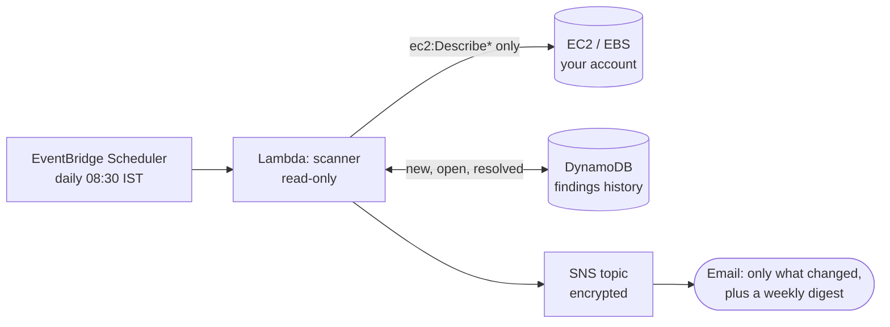
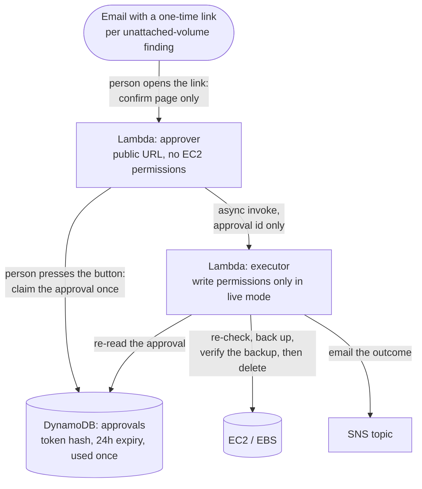

# Cloud Guardian

A serverless AWS cost-governance tool. Every day it scans an account for forgotten, wasteful resources, estimates what each one costs per month, and emails a ranked report.

**Status: working.** Four scanners (unattached EBS volumes, unassociated Elastic IPs, old snapshots, long-stopped EC2 instances). Scanning is read-only. The only thing that can change your account is an approval-gated clean-up of one unattached EBS volume, which stays in dry run (changes nothing) unless you set `cleanup_mode = "live"`. See Approval-gated clean-up below.

## How it works



Unattached-volume findings in the email also carry a one-time clean-up link; see Approval-gated clean-up below.

## What it checks

| Check | What it finds | API used |
|---|---|---|
| `ebs-unattached-volume` | EBS volumes attached to nothing | `ec2:DescribeVolumes` |
| `eip-unassociated` | Elastic IPs allocated but not in use | `ec2:DescribeAddresses` |
| `ebs-old-snapshot` | Your own snapshots older than `snapshot_min_age_days` (default 90) that no AMI uses and no lifecycle service manages | `ec2:DescribeSnapshots`, `DescribeImages`, `DescribeVolumes` |
| `ec2-long-stopped-instance` | Instances stopped for at least `stopped_min_age_days` (default 14). Compute is free while stopped, but the attached disks keep billing | `ec2:DescribeInstances`, `DescribeVolumes` |

## Change-only reporting

Emailing the same list every morning trains people to ignore the email. Findings are stored in DynamoDB, and the daily email covers only what changed:

- **New** findings since the last report
- **Resolved** findings (they stopped appearing)
- a one-line count of everything still open

Once a week (Monday UTC by default, `digest_weekday`) the email lists every open finding. Invoke the Lambda with `{"digest": true}` to get a digest on demand.

Two rules keep the history trustworthy:

- **A finding is only marked announced after the email was actually sent.** If publishing fails, the next run announces it again, so nothing is lost silently.
- **A scanner that crashed never resolves anything.** "I could not look" is not "it is gone", so that scanner's open findings stay open until it succeeds again.

If the history table itself fails, the scan falls back to emailing every finding and says so in the report. A broken history must never hide waste.

## Design

- **Least privilege:** the scanner's role can call those read-only EC2 APIs, publish to one SNS topic, read and write one DynamoDB table (no delete, no scan), create (only create) approval links in a second table, and write its own logs. Nothing else.
- **Opt-out:** tag any resource `guardian:ignore=true` and it is never reported.
- **Evidence on every finding:** the facts a human needs to judge it, plus the cost basis.
- **Failure isolation:** if one scanner errors, the others still run and the email says which one failed (without leaking the error text).
- **Infrastructure as code:** everything is Terraform; state lives in S3 with native locking (no DynamoDB table).

## Approval-gated clean-up

Scanning is read-only. Acting is a separate, much stricter path, and the only action so far is deleting one unattached EBS volume, after backing it up.



1. The scanner adds a one-time link under each unattached-volume finding it lists.
2. **Opening the link only shows a confirmation page.** Email security tools pre-fetch links to scan them, so a link that acted on open could delete your volume. Only the button (a POST, with the token in the body, never the URL) acts.
3. Pressing it uses the approval up (once only) and starts the executor. The executor trusts nothing in that message but an id: it re-reads the approval from the database.
4. It checks the volume again at that moment, takes a backup snapshot, checks the backup, checks the volume once more, and only then deletes.

**One switch, two layers.** `cleanup_mode` in `terraform.tfvars` defaults to `dry_run`. In dry run the button only shows what would happen (and does not use the approval up), and the executor's IAM role has no permission to snapshot or delete, so even a bug in the code could not change anything. `live` turns on both. Only the exact word `false` in the executor's `DRY_RUN` setting enables real actions, and nothing in a message can override it.

The rules, each backed by a test that fails if the rule is removed (every guard was verified by breaking it on purpose):

- **A human approves every action.** The link carries a random one-time token. Only its SHA-256 hash is stored. It expires after 24 hours and can be used exactly once, even if two people click at the same moment.
- **Dry run is the default** and changes nothing.
- **The target is checked at the moment of action,** with the very same function the scanner uses (`evaluate_volume`). Attached since the report? Tagged `guardian:ignore` since? Too new? Then it refuses. Already gone? Nothing to do, and that is not an error.
- **Back up first.** The snapshot must be `completed` and must be a snapshot of this exact volume. If the backup fails or stalls, nothing is deleted.
- **Strict scope.** Only a well-formed `vol-...` id in this region from the `ebs-unattached-volume` check.
- **Runs at most once.** The approval flips to "running" in one conditional write, and automatic retries of the executor are turned off, so a duplicate delivery cannot delete twice. If something fails midway the approval stays used and a human asks again: "never twice" matters more than "retry for me".
- **A second safety layer in IAM.** In live mode the role has an explicit Deny on snapshotting or deleting any volume tagged `guardian:ignore` (any value). AWS also refuses to delete an attached volume.
- **Everything is recorded** against the approval (outcome and detail) and the outcome is emailed.

Things to know:

- Anyone who has the email can use its links for 24 hours. Do not forward it.
- The approver URL is public by necessity (a browser has no AWS credentials). The unguessable token is the only credential. Guessing one is not realistic (256 random bits), and a wrong guess only costs one cheap database read.
- Status: tried end to end on real AWS (Sydney) with one throwaway 1 GiB volume. In dry run, the confirmation page and the button changed nothing and did not use the link up. After switching to live, one approval took a backup snapshot (about 47 seconds, completed, tagged with the volume and approval ids), deleted the volume, and the next scan closed the finding as resolved. The outcome email arrived, and opening the same link again was refused as already used. Then it was switched back to dry run, which removed the write permission again.
- Not yet exercised on real AWS: the IAM Deny for volumes tagged `guardian:ignore` (the code-level `guardian:ignore` check is tested, the IAM layer behind it is not), a backup that fails or stalls, and volumes that are encrypted or larger than a toy size. The tests for those run against a fake AWS only.

## Why not Trusted Advisor or Cloud Custodian?

Short answer: often you should use them. Cloud Guardian is a small, safe-by-default project that shows how a system like this is designed. It does not try to out-feature either tool. The facts below come from the vendors' own documentation as of October 2026, so check the links, because plans and features change.

**AWS Trusted Advisor.** Its cost optimization category includes checks such as EC2 instances stopped for 30 days, idle load balancers (Classic only), idle NAT gateways, idle RDS instances, and EBS volume recommendations. It surfaces recommendations for you to act on. For a small account the catch is the plan: AWS's check reference says the Basic and Developer plans get the service-limit checks plus six security and fault-tolerance checks (no cost checks are listed among them), and API and CLI access needs Business Support+, Enterprise Support or Unified Operations.

**AWS Compute Optimizer.** Its idle recommendations cover 12 resource types, including EBS volumes (flagged as unattached over a 32-day lookback) and EC2 instances (for example peak CPU under 5% and under 5 MB a day of network traffic over 14 days), refreshed daily. Most of its rules look at real usage. Cloud Guardian only looks at state and age, so for detecting what is *idle*, Compute Optimizer is the better tool.

**Cloud Custodian.** A CNCF Incubating project under the Apache-2.0 license: a rules engine where YAML policies name a resource type, filters, actions and a mode (for example event-driven or scheduled), across AWS, Azure and GCP. It can express checks like the ones in this repository and many more. For a real organisation it is usually the better starting point.

What Cloud Guardian offers instead:

- **Safe behaviour built in and tested, not assembled.** Change-only emails, one-time human-approved links that expire, a backup before every delete, an independent re-check at the moment of action, a run-once guard, an approver with no EC2 permissions, a separate executor, and an IAM deny on anything tagged `guardian:ignore`. With a general rules engine you would design most of those yourself.
- **Small enough to audit.** About 2,000 lines of Python in `src/` and about 2,600 lines of tests, and each of the clean-up's code guards has a test that fails when the guard is removed (checked by breaking them on purpose).
- **No special plan needed.** It runs on an account with no paid support plan and no other AWS services to opt in to.
- **Honest limits.** Four checks, one action, one region per deployment, usage is not measured, and costs are approximate list prices.

| If you want... | Use |
|---|---|
| AWS-maintained recommendations based on real usage | Compute Optimizer (and Trusted Advisor, if your plan includes it) |
| Policy-as-code across many resource types, accounts or clouds | Cloud Custodian |
| A small, auditable, quiet-by-default scanner with an approval-gated clean-up, or a worked example of building one | Cloud Guardian |

Sources: [Trusted Advisor check reference](https://docs.aws.amazon.com/awssupport/latest/user/trusted-advisor-check-reference.html), [Trusted Advisor cost optimization checks](https://docs.aws.amazon.com/awssupport/latest/user/cost-optimization-checks.html), [Compute Optimizer idle recommendations](https://docs.aws.amazon.com/compute-optimizer/latest/ug/view-idle-recommendations.html), [Cloud Custodian on GitHub](https://github.com/cloud-custodian/cloud-custodian).

## Cost estimates: read this

Estimates are approximate list prices (`src/scanners/pricing.py`) and are **not** checked against the live AWS price list.

- EBS: storage only, from us-east-1 prices times a rough regional multiplier. Provisioned IOPS, throughput and snapshot costs are ignored, so this under-estimates.
- Elastic IP: the public IPv4 hourly charge times 730 hours.
- Snapshots: full source-volume size at the standard-tier price, with no regional adjustment. Snapshots are incremental, so real cost is usually lower.
- Stopped instances: the attached EBS volumes only, priced like the EBS estimate above. Snapshots, AMIs and Elastic IPs tied to the instance are not counted.

Treat them as a ranking signal, not billing data.

## Known limitations

- `MIN_AGE_DAYS` filters on volume *creation* age, because `DescribeVolumes` does not report when a volume was detached. A precise "unattached for N days" needs CloudTrail.
- `DescribeAddresses` reports no allocation time, so Elastic IPs have no age filter: a brand-new address you are about to attach is reported until it is associated. Tag it `guardian:ignore=true` if that matters.
- Detection looks at state and age only, never at actual use (CPU, network, disk activity). AWS Compute Optimizer does look at usage; see the comparison above.
- One region per deployment. Scan several regions by deploying once per region.
- "Stopped for N days" comes from the timestamp inside the instance's `StateTransitionReason` text (`DescribeInstances` has no stop-time field). Some stops carry no timestamp, for example a shutdown from inside the operating system. For those the stop time is unknown: an instance launched less than `stopped_min_age_days` ago is skipped, and an older one is reported but marked "stop time unknown" instead of guessing. CloudTrail would give an exact answer and is a later improvement.
- Snapshots are skipped when an AMI you own references them, or when they carry a `dlm:managed` or `aws:backup*` tag. Deleting one snapshot in a chain may free little space, because later snapshots can depend on its blocks.

## Quick start

Prerequisites: AWS CLI v2 with credentials configured (`aws configure` with an IAM user; do not enable IAM Identity Center or AWS Organizations on a Free plan account, since AWS says that converts it to a paid plan), Terraform >= 1.10, Python 3.12+.

Some accounts (for example ones managed under an organization) only allow certain regions. Check that EC2, Lambda, SNS, Scheduler and S3 respond in your region before deploying, and set `region` in `terraform.tfvars` and `backend.hcl` to match.

macOS / Linux:

```bash
# 0. Local checks
python -m venv .venv && source .venv/bin/activate
pip install -r requirements-dev.txt
pytest -q

# 1. One-time: create the Terraform state bucket
cd terraform/bootstrap
terraform init && terraform apply -var="region=YOUR_REGION"
# note the "state_bucket" output

# 2. Deploy the stack
cd ..
cp backend.hcl.example backend.hcl            # put your bucket and region in
cp terraform.tfvars.example terraform.tfvars  # put your email and region in
terraform init -backend-config=backend.hcl
terraform plan
terraform apply

# 3. Confirm the subscription email from AWS, then run a scan now
aws lambda invoke --function-name cloud-guardian-scanner --region YOUR_REGION \
  --cli-binary-format raw-in-base64-out --payload '{}' out.json && cat out.json
```

Windows (PowerShell) differs in three places:

```powershell
.venv\Scripts\Activate.ps1                                  # instead of source
copy backend.hcl.example backend.hcl                        # instead of cp
terraform init "-backend-config=backend.hcl"                # quotes are required
aws lambda invoke --function-name cloud-guardian-scanner --region YOUR_REGION --cli-binary-format raw-in-base64-out --payload "{}" out.json
type out.json
```

To see real findings, create a tiny test volume and an Elastic IP (both cost a few cents), set `min_age_days = 0` in `terraform.tfvars`, apply, and run the scan:

```bash
aws ec2 create-volume --availability-zone YOUR_REGIONa --size 1 --volume-type gp3 --region YOUR_REGION
aws ec2 allocate-address --domain vpc --region YOUR_REGION
```

Delete both afterwards (`aws ec2 delete-volume ...`, `aws ec2 release-address --allocation-id ...`). To remove the whole stack: `terraform destroy` in `terraform/`.

## Looking at the history

```bash
aws dynamodb scan --table-name cloud-guardian-findings --region YOUR_REGION \
  --query "Items[].[status.S,check.S,resource_id.S,first_seen.S,last_seen.S]" --output table
```

The table is not backed up on purpose: it is derived from AWS state, so losing it only restarts the first-seen history. (Your own IAM user can scan it; the Lambda's role cannot.)

## Staying inside free credits

All services used here (Lambda, SNS, EventBridge Scheduler, S3, DynamoDB on-demand, CloudWatch Logs) are effectively free at this scale. Avoid NAT gateways, load balancers and RDS instances in anything you add. Set a Budget alert before deploying.

## Roadmap

- [x] Unattached EBS scanner, Terraform, tests, CI
- [x] Unassociated Elastic IP scanner, multi-scanner handler with failure isolation
- [x] Old-snapshot scanner with AMI-in-use and lifecycle-managed exclusions
- [x] Long-stopped EC2 instances scanner
- [ ] More scanners: idle RDS, untagged resources
- [x] Findings history in DynamoDB, change-only emails, weekly digest
- [ ] Simple dashboard
- [x] Approval-gated clean-up core for unattached EBS volumes: one-time expiring approvals, re-check before acting, backup before delete, dry-run by default
- [x] Safety test suite for that core: refuses on `guardian:ignore`, expired or used approval, changed state, duplicate action, out-of-scope resource (each guard verified by breaking it on purpose)
- [x] Connected: one-time links in the email, public confirmation page, separate executor, dry run by default
- [x] Tried end to end on a real test volume (dry run first, then live)
- [ ] Exercise the remaining live paths on real AWS (IAM Deny on `guardian:ignore`, encrypted volume)
- [ ] Optional: run the executor steps as a Step Functions workflow for a visual run history
- [x] Architecture diagrams and an honest comparison with Trusted Advisor and Cloud Custodian
- [ ] GitHub Actions deploy via OIDC (no stored keys)
- [ ] Reproducible evaluation on seeded waste scenarios (precision, recall, scan time)
- [ ] Optional: AI-written explanations of findings (never makes decisions)

## Repo layout

```
src/handler.py                     Lambda entry point, scanner orchestration, report formatting
src/findings_store.py              Findings history (DynamoDB): new / still open / resolved
src/approver.py                    Public confirmation page for clean-up links (no EC2 permissions)
src/cleanup_executor.py            Carries out one approved clean-up (the only function that can act)
src/remediation/approvals.py       One-time, expiring approval tokens (DynamoDB, hashed)
src/remediation/ebs_delete.py      Back up then delete one unattached volume, with guards
src/remediation/executor.py        Approval to action, plus an audit record
src/scanners/common.py             Finding type and shared helpers (ignore tag, severity)
src/scanners/ebs_unattached.py     Unattached EBS volumes
src/scanners/eip_unassociated.py   Unassociated Elastic IPs
src/scanners/snapshots_old.py      Old, unused snapshots
src/scanners/ec2_stopped.py        Long-stopped EC2 instances and the disks they still bill for
src/scanners/pricing.py            Cost estimation (approximate)
tests/                             pytest + moto (mocked AWS, no account needed)
terraform/                         Main stack (cleanup.tf holds the clean-up pieces)
terraform/bootstrap/               One-time state bucket
.github/workflows/ci.yml           Lint, test, terraform validate, Checkov, gitleaks
```
